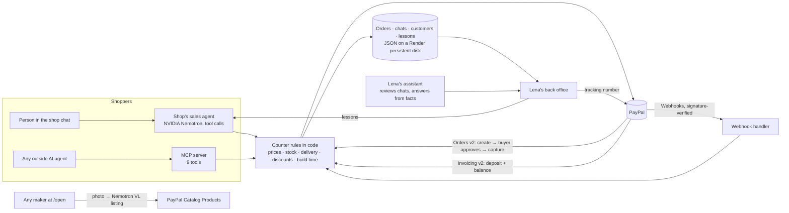

# Open Counter

**A one-person maker's shop that any AI shopping agent can buy from. Paid through PayPal, approved by a human, and
run by a sales agent the maker teaches herself.**

People increasingly ask an AI assistant for a gift, and those assistants buy from big stores. PayPal's agentic
checkout exists, but it is request-access and built for platform stores. A maker who sells a few things a week is not
on that path. Open Counter is the other half: it makes a small shop *readable* to every agent (a page, a JSON card and
an MCP server), *payable* through PayPal, and still *hers*: nothing is charged until a person approves in PayPal, her
rules hold in code, and she can see and correct what her agent says.

The demo maker is Lena, who builds 1:43 replica cars by hand ($59 each). Any other maker can open a counter at `/open`.

Built for the PayPal AI Hackathon 2026 by Elite Product LLC.

## Try it in two minutes
- **Shop:** https://open-counter.onrender.com · chat with the shop's sales agent in section 01, turn any car in 3D.
- **Lena's back office (open, no login):** https://open-counter.onrender.com/maker
- **Open your own counter:** https://open-counter.onrender.com/open
- When the agent gives you a PayPal button, log in with the **sandbox** test buyer:
  `sb-yi0xc53507798@personal.example.com` / `2dt_AD6W`. This is PayPal's test environment; no real money moves.
- The back office starts with two weeks of sample history (marked SAMPLE) so the charts aren't empty. Your own chat
  and order appear on top, live.

## What it does
**For the shopper (or their agent)**
- Ask in English or Russian (tested; other languages work as the model allows). The agent finds the car, checks stock and delivery, gives the total and dates, asks once for
  name, phone, email and address, and puts a receipt under its message: one line per car, quantity × price, shipping,
  total, and a PayPal button. Several different cars go into one PayPal order.
- Something not on the shelf? Describe it. The agent asks the year, body and interior colours and the quantity, and
  quotes the build time and volume discount from Lena's rules. It's paid with a **PayPal invoice: 50% deposit now,
  the balance before shipping.**
- Any outside agent gets the same nine tools through the MCP server, with the same rules.

**For the maker**
- **Back office** with one period filter (today … year) over every tab: orders, numbered chats by day with the
  buyer's name (or "Guest, no name"), insights (cars sold per model in the cars' own colours, best sellers, when
  shoppers come, how often a chat becomes an order, where the agent got stuck), customers, stock.
- **She teaches her agent.** Under any chat: "Teach the AI from this chat". Lena's lessons go into every new chat.
  On this public demo a visitor's lesson applies to that visitor's own chats only, so nobody can change the shop's
  agent for other people (Lena's key, `MAKER_KEY`, makes a lesson global).
- **Her assistant** reviews the latest chats, points at the answers that went wrong and writes the lesson for her to
  accept in one tap. It also answers "how much did I make this week?" from numbers computed in code.
- **Customers and consent:** buyers are asked once, after their first order, whether Lena may email them about new
  models. Only a yes in their own words puts them on the list.
- **Open your counter (`/open`):** one photo and one sentence. NVIDIA Nemotron VL writes the listing words; the maker
  sets price and stock; the product is registered in PayPal Catalog Products and gets its own agent-readable card.

## How it works


## What uses PayPal, and where
| PayPal API | What for | Code |
|---|---|---|
| OAuth 2.0 client credentials | server-side token, cached and refreshed on 401 | `opencounter/paypal.py` |
| Orders v2: create (CAPTURE) | stock orders: one item per car, shipping, the buyer's address (`SET_PROVIDED_ADDRESS`) | `paypal.create_order` |
| Orders v2: approval link → capture | the human's yes; stock re-checked at capture | `web._settle` |
| Invoicing v2: create, send, partial payment, remind | made-to-order: 50% deposit now, balance before shipping | `paypal.create_deposit_invoice`, `remind_invoice` |
| Orders v2: shipment tracking | Lena adds a USPS number, PayPal tells the buyer | `paypal.add_tracking` |
| Payments v2: refund | automatic full refund if the last one sold during approval | `paypal.refund` |
| Catalog Products v1 | products of makers who open a counter at `/open` | `onboard.publish` |
| Webhooks + signature verification | `CHECKOUT.ORDER.APPROVED` (captured even if the buyer never returns), capture completed/denied/reversed/refunded, invoice paid/updated | `web.webhook` |
| `PayPal-Request-Id` | a retried create, capture, invoice or refund never doubles money | `paypal._call` |

## What uses AI, and where
- **Sales agent** (`opencounter/shopper.py`): NVIDIA Nemotron 3 Super on Nebius, native tool calls, answers in the
  shopper's language, daily spend cap. It reads Lena's lessons in every chat.
- **What the model is not trusted with:** prices, totals, discounts, stock, delivery dates and build times are computed
  in `opencounter/shop.py`. The code refuses an order unless the phone, email and ZIP were typed by the person; lines
  with contact details the person never typed are removed from replies; a promised link without a real order is caught.
- **Lena's assistant** (`opencounter/assistant.py`): reviews chats against the shop's facts and proposes lessons;
  answers questions from a facts object computed in code.
- **Listing writer** (`opencounter/onboard.py`): NVIDIA Nemotron VL turns a photo and a sentence into listing words.

## For agents
- MCP (streamable HTTP) at `/mcp/`: `about_counter`, `search_counter`, `item_details`, `delivery_estimate`,
  `start_checkout` (one or several cars), `quote_commission`, `start_commission_checkout`, `leave_contact`, `order_status`.
- JSON card: `/c/small-garage.json`; every counter: `/c/<slug>.json`; discovery: `/.well-known/open-counter.json`.

## Run locally
```bash
python3.12 -m venv .venv && .venv/bin/pip install -r requirements.txt pytest
export PAYPAL_CLIENT_ID=... PAYPAL_CLIENT_SECRET=...   # sandbox app
export NEBIUS_API_KEY=...                              # sales agent, assistant, listing writer
export OPENCOUNTER_PUBLIC_URL=http://127.0.0.1:8800
.venv/bin/uvicorn opencounter.web:app --port 8800
.venv/bin/python -m pytest -q tests
```
Optional: `PAYPAL_WEBHOOK_ID` (webhook verification), `OPENCOUNTER_DATA` (data folder; on Render it points at a
mounted persistent disk, `/var/data`, so data survives deploys), `MAKER_KEY` (Lena's key: global lessons, news-list export).

On the public demo every browser gets its own visitor id: lessons it writes, orders it can ship and counters it opens
stay with that browser. Sample history (marked SAMPLE) is read-only.

## Tools used while building
Claude Code wrote code and tests with us, using PayPal's developer docs. Product photos, the 3D models and the bench
clips are AI-generated (Higgsfield); the shop, Lena and the sample history are fictional. No car brands or logos.

## License
MIT. See LICENSE.
