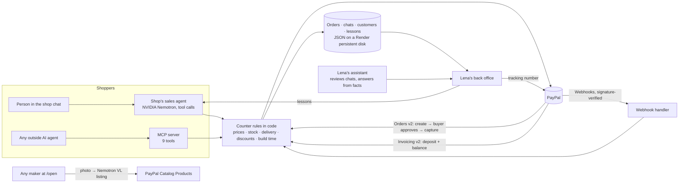
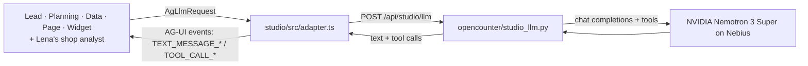

# Open Counter

**A one-person maker's shop that any AI shopping agent can buy from. Paid through PayPal, approved by the buyer in PayPal, and
run by a sales agent the maker teaches herself.**

[](https://render.com/deploy?repo=https://github.com/chainwright/open-counter)

People increasingly ask an AI assistant for a gift, and those assistants buy from big stores. PayPal's agentic
checkout exists, but it is request-access, and Store Sync launched through commerce platforms like Wix and
BigCommerce. A maker who sells a few things a week from her own page is not on that path. Open Counter is the other
half: it makes a small shop *readable* to any agent that's given its address (a page, a JSON card and an MCP server), *payable* through PayPal, and still *hers*: nothing is charged until a person approves in PayPal, her
rules hold in code, and she can see and correct what her agent says.

The demo maker is Lena, who builds 1:43 replica cars by hand ($59 each). Any other maker can open a counter at `/open`.

Built for the PayPal AI Hackathon 2026 by Elite Product LLC.

## Why it matters
- Traffic from AI assistants to US retail sites grew **693%** in the 2025 holidays vs 2024 ([Adobe Analytics](https://news.adobe.com/news/2026/01/adobe-holiday-shopping-season)).
- About **70%** of Americans could imagine using AI tools to pick Christmas gifts ([Statista, 2025](https://www.statista.com/chart/35529/ai-tools-adoption-and-applications-for-holiday-shopping)).
- Etsy alone had **5.6 million** active sellers at the end of 2025 ([Inside Retail](https://insideretail.us/etsy-vows-sustained-growth-after-revenue-lift/)): makers like Lena.
- PayPal's agentic checkout (Store Sync, Agent Ready) is request-access, and Store Sync launched through commerce
  platforms like Wix and BigCommerce ([PayPal docs](https://developer.paypal.com/agentic-commerce-services/about)). Open
  Counter gives a one-person shop an agent door with what any PayPal account already has.

## Does it work? Measured, not claimed
`evals/run_evals.py` runs 33 scripted conversations against the live model (English and Russian, deadlines, discounts,
a changed cart, details typed over several messages, made to order, a wrong ZIP, brand names, an injected instruction, talking to Lena) on a fresh shop each,
with checks written in code. Latest results and every transcript: [`evals/RESULTS.md`](evals/RESULTS.md),
`evals/transcripts.json`. Every answer has a 7-second budget: when the model runs out of time, the reply is written by
code from what the tools already found (price, dates, what's still needed), and if they found nothing yet, from the
shelf itself (what's in stock, shipping, how to order). A shopper never waits on a spinner and is never asked to send
the message again. Every case also checks that each answer arrived within 8 s (budget plus network).

Honest numbers: the latest live run (8 Nov 2026, on the code deployed that day, after the made-to-order and safety changes; the same strict checks: no reply may ask the person to resend, "on time" must really say it, the ship date must be the one the shop's tool returned) passed **32 of 33**, median 2.7 s per case, slowest single answer 5.8 s: [`evals/RESULTS.md`](evals/RESULTS.md). The miss is the model's wording, not money or stock: in "colour and year only", a chat that changes its mind about which car three times, the last reply asked for the address again without naming the car or the price. A first run the same day passed 31 of 33 and found one gap that was ours: asked for 40 green fastbacks, the agent asked for the contact details instead of the year of the real car. That reply is now written in code (the year first, then the price), and the second run passed it. The saved replies re-checked offline agree: 32 of 33 ([`evals/RESCORE.md`](evals/RESCORE.md)). The run before (31 Oct) passed 31 of 33. The model varies run to run, so the pass rate is the number we report.

The closed-tab case, run on the live sandbox on 28 Oct 2026: order `OC-C7DAD2E3` (PayPal order `9NC75431R2481360K`)
was approved by a person while the return page was told to stay out of it (a `webhook-only-test` visitor). PayPal's
`CHECKOUT.ORDER.APPROVED` webhook arrived, its signature was verified, and the webhook handler captured the payment
(capture `9Y869986895732623`, 20:18 UTC); the order showed as paid on Lena's side without the buyer's browser doing
anything. Same code path as the return page, so the two can never charge twice.

The made-to-order invoice, run on the live sandbox on 8 Nov 2026: order `OC-84F49F07` (2 × fastback, 1967, $184.50),
PayPal invoice `INV2-VV7G-JLS2-JXCV-3QTR`. The buyer chose *Partial amount* on PayPal's invoice page and paid the
$92.25 deposit with the sandbox buyer; the invoice read "Partially paid", the order moved to `deposit_paid` within
seconds, and the balance reminder went out through PayPal from Lena's back office. (An earlier run the same day:
`OC-2C9A66AA`, invoice `INV2-2WXK-33LT-AN9D-FKRN`.) The automatic refund (last car sold during approval) is covered by
tests with PayPal stubbed; it has no sandbox run. The demo clears test-run orders from Lena's back office on every
restart, so these two order ids no longer show there; the PayPal invoice ids above are the lasting record.

**Logged run: outside MCP client → paid** (live sandbox, 9 Nov 2026, UTC). An outside client, MCP Inspector CLI 0.17.2
(`npx @modelcontextprotocol/inspector --cli https://open-counter.onrender.com/mcp/ --transport http`), called
`tools/list`, `search_counter` ("green"), `delivery_estimate` (CO) and `start_checkout` (`sg-014`, quantity 1) at
20:55:25–20:55:33. That made order `OC-DDAED237` ($59.00 + $6.50 shipping = $65.50) and PayPal order
`7CH35233YB660681A`. The sandbox buyer approved in PayPal at 20:56:00 (the approval was a scripted login as the sandbox buyer), the return page captured it (capture
`1YL21413K6318972K`, `COMPLETED`, 20:56:02), `order_status` over MCP then said `paid`, and Lena's studio shows it as the
newest MCP checkout, paid. PayPal's address on file for the test buyer is in CA, so the order follows CA, not the CO
the agent asked about. Every call and answer: [`web/static/agents_run.json`](web/static/agents_run.json), replayed at
[`/agents`](https://open-counter.onrender.com/agents).

**Logged run 2: an AI agent over MCP → paid** (live sandbox, 9 Nov 2026, UTC). An AI agent (Claude, via Claude Code
headless) chose the calls; approval was a scripted sandbox buyer login. Claude Code 2.1.321 ran
`claude -p "Find a green fastback under $70 that ships to Denver and start the checkout."` with
`--strict-mcp-config --mcp-config` naming only `https://open-counter.onrender.com/mcp/` and `--tools ''`, so its only
tools were our nine (model `claude-opus-5-5`). Starting at 21:38:16, the model called `search_counter` ("green
fastback", max $70), `delivery_estimate` (CO) and `start_checkout` (`sg-014`, quantity 1, CO), then showed the shopper
both lines and the approve link. That made order `OC-18CD6CD1` ($59.00 + $6.50 = $65.50) and PayPal order
`0FB605538J1498548`. A script logged in as the sandbox buyer and approved at 21:38:44; the return page captured it
(capture `2B9863740U9168337`, `COMPLETED`, 21:38:46). In a second turn of the same session ("I approved it in PayPal. Is
it paid now?") the model called `order_status` and answered that it is paid. The full transcripts (stream-json, local
folder paths replaced), the command, the approval log and PayPal's order record:
[`docs/runs/2026-11-09-claude-code-mcp-purchase/`](docs/runs/2026-11-09-claude-code-mcp-purchase/); replayed at
[`/agents`](https://open-counter.onrender.com/agents) as the first recording.

## Try it in two minutes
- **Shop:** https://open-counter.onrender.com · chat with the shop's sales agent in section 01, turn any car in 3D.
- **Lena's back office (open, no login):** https://open-counter.onrender.com/maker
- **Open your own counter:** https://open-counter.onrender.com/open
- **For AI agents (MCP):** https://open-counter.onrender.com/agents · call the real MCP server from the page, and
  replay an outside agent's purchase through to capture
- **Lena's studio (AG Studio), best on a laptop:** https://open-counter.onrender.com/studio/ · the lesson loop on one
  screen: https://open-counter.onrender.com/studio/loop.html
- When the agent gives you a PayPal button, log in with the **sandbox** test buyer:
  `sb-yi0xc53507798@personal.example.com` / `2dt_AD6W`. This is PayPal's test environment; no real money moves.
- The back office starts with two weeks of sample history (marked SAMPLE) so the charts aren't empty. Your own chat
  and order appear on top, live.

## What it does
**For the shopper (or their agent)**
- Ask in English or Russian (tested; other languages work as the model allows). The agent finds the car, checks stock and delivery, gives the total and dates, asks once for
  name, phone, email and address, and puts a receipt under its message: one line per car, quantity × price, shipping,
  total, and PayPal's own button: the buyer approves in PayPal's window without leaving the chat. Several different cars go into one PayPal order.
- Something not on the shelf? Describe it. The agent asks the year of the real car first (and the body and interior
  colours and the quantity if they're missing), then quotes the total, the build time and the ship date from Lena's
  rules (ten or more cars also get a volume discount). It's paid with a **PayPal invoice: 50% deposit now, the balance
  before shipping.** On PayPal's invoice page, *Partial amount* pays just the deposit.
- Any outside agent gets the same nine tools through the MCP server, with the same prices, stock and dates.

**For the maker**
- **Back office** with one period filter (today … year) over every tab: orders, numbered chats by day with the
  buyer's name (or "Guest, no name"), insights (cars sold per model in the cars' own colours, best sellers, when
  shoppers come, how often a chat becomes an order, where the agent got stuck), customers, stock.
- **She teaches her agent.** Under any chat: "Teach the AI from this chat". Lena's lessons go into every new chat.
  On this public demo a visitor's lesson applies to that visitor's own chats only, so nobody can change the shop's
  agent for other people (Lena's key, `MAKER_KEY`, makes a lesson global).
- **Her assistant** reviews the latest chats, points at the answers that went wrong and writes the lesson for her to
  accept in one tap. It also answers "how much did I make this week?" from numbers computed in code.
- **Customers and consent:** buyers are asked once, after their first order, whether Lena may email them about new
  models. Only a yes in their own words puts them on the list.
- **Open your counter (`/open`):** one photo and one sentence. Shoppers can buy from a new counter at `/c/<slug>` the
  same way (PayPal approval by a person, stock taken at capture). The maker gives her PayPal email and each order names
  her account as PayPal's `payee`, so Open Counter never holds the money. The sandbox can only pay its own test
  accounts (`…@business.example.com`) and accepts any other email at create, failing later at approval or capture,
  so in the sandbox any other email (or none) pays the Open Counter test merchant, and the page and card say so. If
  a counter sells out while a buyer is in PayPal, the platform can't refund from her account: the order becomes
  `refund_due` and her back office says to refund from her PayPal. In this demo nothing reaches her outside that page. NVIDIA Nemotron VL writes the listing
  words; the maker sets price and stock; the product is registered in PayPal Catalog Products and gets its own
  agent-readable card.
- **Your whole range at once (`/open`, second mode):** a maker pastes her price list ("Brass bell 6cm $24, Oak
  coaster set of 4 $32 …" or one item per line). NVIDIA Nemotron on Nebius reads it, on the same budget as the shop's
  agent; when the model is busy or over budget, a rule parser reads "name … $price" lines instead. Code checks every
  item: a price is kept only if the maker wrote that number (a model can't invent or change one), above $0 and up to
  $10,000; names are plain text, 60 characters at most, with markup and instructions to an AI taken out; 12 items at
  most. She sees every line in a table, fixes or removes what's wrong, adds stock and, if she likes, one photo; the
  server checks every value again when she opens the counter (`onboard.publish_many`). Each item is registered as its
  own PayPal Catalog Product. The counter's page lists every item with one PayPal checkout for the item a buyer picks,
  and the counter gets **its own MCP server at `/c/<slug>/mcp/`** (`about_counter`, `search_counter`,
  `start_checkout` for any item, `order_status`); Lena's `/mcp/` keeps its nine tools. Reading a list is rate-limited
  per network and per browser. Code: `opencounter/pricelist.py`, `opencounter/counter_door.py`; tests:
  `tests/test_range.py`.
  - **From a photo of a price list or menu:** the pinned vision model `nvidia/Nemotron-3.5-Super-VL` (the one
    image-input model on Nebius Token Factory) reads it into the same table. JPEG, PNG or WebP only, about 3 MB and
    30 MP at most (checked from the header before decoding), re-encoded in memory and never stored; it becomes the
    counter's photo only if she adds it as one. A photo has no typed text to hold prices against, so the page asks
    her to check each price. `/open` has a drawn sample board to try.
  - **From her website:** the server reads the one page she gives. Products come from the page's schema.org JSON-LD
    (Product / Offer, USD) when it has it, with no AI; otherwise only the page's priced lines (menus, country pickers
    and footers dropped) go to the same list reader, so a price is kept only if it's written on the page. This is an
    outbound call a visitor aims, so it is guarded (`opencounter/webfetch.py`): https on port 443 only, no
    credentials in the URL; every address the host resolves to must be public (private, loopback, link-local, cloud
    metadata, CGNAT, multicast and reserved ranges refused, IPv4-mapped IPv6 included) and the connection goes to the
    checked address with the certificate checked against the host name, so a DNS answer that changes afterwards
    (rebinding) is never used; at most 3 redirects, each checked from scratch; 8 s, 2 MB (also after gzip), HTML only,
    no cookies; rate-limited per network and per browser. `tests/test_webfetch.py` covers 127.0.0.1,
    169.254.169.254, `[::1]`, encoded IPs, a name with one private address, a rebinding name, redirects to private
    addresses, `http://` and to Instagram, huge bodies and a gzip bomb. Our own range pages carry the same JSON-LD.
  - **From Instagram, by screenshots only:** Instagram doesn't let other sites read its pages and we don't scrape it,
    so an Instagram address is never fetched; the page says so and opens the screenshot tab. She adds screenshots of
    up to 6 posts; the same vision model reads the product, price and caption from each (never usernames, likes or
    hashtags), with the same image caps, nothing stored, and a caption that tries to instruct an AI is dropped.

## How it works


## What uses PayPal, and where
| PayPal API | What for | Code |
|---|---|---|
| OAuth 2.0 client credentials | server-side token, cached and refreshed on 401 | `opencounter/paypal.py` |
| Orders v2: create (CAPTURE) | stock orders: one item per car, shipping, the buyer's address (`SET_PROVIDED_ADDRESS`); for a counter opened at `/open`, `payee` is the maker's own PayPal account | `paypal.create_order`, `onboard.checkout` |
| Orders v2: approval link → capture | the human's yes; stock re-checked at capture | `web._settle` |
| Invoicing v2: create, send, partial payment | made-to-order: 50% deposit now, balance before shipping | `paypal.create_deposit_invoice` |
| Invoicing v2: get invoice, send reminder, **through PayPal's Agent Toolkit** | the invoice status read (deposit in → Lena builds; fully paid → ships) and Lena's "Cars ready: request the balance" button | `paypal.get_invoice`, `paypal.remind_invoice` |
| Orders v2: shipment tracking | Lena adds a USPS number, PayPal tells the buyer | `paypal.add_tracking` |
| Payments v2: refund | automatic full refund if the last one sold during approval | `paypal.refund` |
| Catalog Products v1 | Lena's five listings and the sample counters, registered on start under fixed ids (`OC-SG-014`…, looked up, never duplicated) and shown on every card; products of makers who open a counter at `/open` (registered when the counter opens, under the id PayPal assigns) | `catalog.sync`, `onboard.publish` |
| Webhooks + signature verification | `CHECKOUT.ORDER.APPROVED` (captured even if the buyer never returns), capture completed/denied/reversed/refunded, invoice paid/updated | `web.webhook` |
| `PayPal-Request-Id` | a retried create, capture, invoice or refund never doubles money | `paypal._call` |

**PayPal Agent Toolkit, and where it isn't used.** Two calls go through PayPal's official Python
[Agent Toolkit](https://pypi.org/project/paypal-agent-toolkit/) (`paypal-agent-toolkit==1.11.0`): its `get_invoice`
and `send_invoice_reminder` tools, run directly through the Toolkit's framework-free core (`PayPalAPI.run`), with no
LLM choosing them. If the Toolkit fails, is missing or takes over 20 s, the same call goes out through our own REST
client, and the order records which path served it (`invoice_via`, `balance_via`: `paypal-agent-toolkit` or
`rest-fallback`). Tests: `tests/test_paypal_toolkit.py` (Toolkit answers; Toolkit raises, hangs or is missing → REST).
Checked against the sandbox on 9 Nov: invoice `INV2-VV7G-JLS2-JXCV-3QTR` read as `PARTIALLY_PAID` ($92.25) and a
reminder sent, both through the Toolkit (checked by us; not logged in the repo). Everything else in the table above (orders, capture, tracking, refunds,
catalog, webhooks, invoice create and send) is our own REST client in `opencounter/paypal.py`. The Docker image installs
the Toolkit with `--no-deps` (`requirements-paypal-toolkit.txt`): its core needs only `pydantic` and `requests`, and its
declared LangChain/CrewAI/OpenAI Agents extras would add about 500 packages we never import.

## What uses AI, and where
- **Sales agent** (`opencounter/shopper.py`): NVIDIA Nemotron 3 Super on Nebius, native tool calls, answers in the
  shopper's language, and reads Lena's lessons in every chat.
- **AI budget.** One daily cap for the whole demo (`SHOPPER_DAILY_CAP_USD`, default $1.00/day), and inside it a share
  per browser (`SHOPPER_VISITOR_CAP_USD`, $0.15) and per network (`SHOPPER_IP_CAP_USD`, $0.30). The network is the
  visitor's address as Cloudflare reports it in front of Render (`CF-Connecting-IP`, read only on Render), which a
  client can't set; elsewhere the last `X-Forwarded-For` hop (`OPENCOUNTER_PROXY_HOPS`). Checked live on 8 Nov: the
  key is the visitor's own address, a client-sent `CF-Connecting-IP` is refused by Cloudflare, and a client-sent
  `X-Forwarded-For` or `True-Client-IP` changes nothing.
  The budget is checked only when a turn needs the model: answers written in code (the made-to-order year question,
  quote and invoice, a cart made in code, safety answers) work even when the day is spent. The studio has its own pool
  (`STUDIO_DAILY_CAP_USD`).
- **What the model is not trusted with:** prices, totals, discounts, stock, delivery dates and build times are computed
  in `opencounter/shop.py`. The code refuses an order unless the phone, email and ZIP were typed by the person; lines
  with contact details the person never typed are removed from replies; a promised link without a real order is caught.
- **Why so many guards in `shopper.py`, and how they're measured.** The shop's chat is a small open model on a
  7-second budget, so the answers a shopper must never miss (the deadline verdict, the total with shipping, "we ship
  inside the US only", the discount rule, Lena's lessons) are checked in code after the model replies and added if
  it left them out. Each guard is a narrow pattern, so it can misfire on phrasing nobody tried; that's the trade for
  never inventing a price or a date. Two things keep it honest: every guard has an offline test with the model faked
  (`tests/`), and `evals/run_evals.py` replays 33 real conversations with checks in code, including a global ban on
  non-answers. Moving the guards into their own module is on the list.
- **Lena's assistant** (`opencounter/assistant.py`): the same model without tools: it reviews chats against the shop's
  facts and proposes lessons (streamed into the studio's cell), and answers questions from a facts object computed in
  code.
- **Listing writer** (`opencounter/onboard.py`): NVIDIA Nemotron VL turns a photo and a sentence into listing words.

## Lena's studio (AG Studio)
`/studio/` is Lena's dashboard on [AG Studio](https://www.ag-grid.com/) 3.0 (React), served by the shop itself. It
answers one question: *where did my agent get stuck, did my lesson fix it, and what did that earn?*

**What's on the page** (`studio/src/main.tsx`)
- **Where my agent got stuck** (custom widget, `studio/src/StuckWidget.tsx`): what the shopper asked, the agent's
  original reply struck through in red pencil, Lena's lesson, and a ✓ or ✗ for every later chat that asked the same
  thing, with the paid value of orders from those chats. Rows with no lesson yet (one per question, with how many chats
  asked it) have **Draft a lesson**: the server streams
  the model's tokens as AG-UI events (`TEXT_MESSAGE_START / _CONTENT / _END`, then `RUN_FINISHED` with whether the
  shop's matcher understands it), and the cell draws each token as it arrives (`studio/src/lessonStream.ts`).
  **Accept** saves it as a lesson; the next matching chat draws its ✓ live. All numbers come from
  `/api/maker/agent_misses` (`opencounter/misses.py`), computed in code. On the public demo a visitor sees the sample
  history and their own chats, never other visitors'.
- **Agent checkouts** (custom widget, `studio/src/SoldStrip.tsx`): checkouts started this week by who started them
  (an outside AI agent over MCP, Lena's sales chat, made to order), counted once started, paid or still awaiting the
  buyer's approval in PayPal; and the newest MCP checkout with its PayPal status (marked SAMPLE for sample orders).
- Studio's own widgets: a column chart (chats vs orders, `daily` source) and an AG Grid table of orders (`sales` source).
  Both custom widgets are registered with `createWidgets`, each with `ai` metadata and a `formatShape`, so Studio's
  agents can place and configure them.
- One theme, `studioTheme.withParams` (`studio/src/theme.ts`), across Studio's panels, chat, grid and chart.

**The agents** (`studio/src/harness.ts`)
- AG's five built-in agents (Lead, Planning, Data, Page, Widget) all run through our own model adapter
  (`directLlmRunner({... adapter})`), plus a sixth, **Lena's shop analyst** (`id: 'shop'`), with two tools defined by
  `api.defineAiTool`: `agent_misses` and `agent_sales`, which call the shop's endpoints.
- The Lead hands shop questions to the analyst through Studio's own `delegate_to`. So the chat shows Lead → Lena's
  shop analyst for a shop question, and Lead → Page agent → Widget agent when Lena asks for a new panel; the analyst
  can also hand its own widgets to them.

**How the adapter works**

`studio_llm.py` turns Studio's Responses-style items into chat messages (consecutive tool calls in one assistant
message, Studio-provided tools dropped) and back. The model key stays on the server. A turn that only announces its
next step ("Now I'll place the widget:") without a tool call is asked once more with a tool call required. A whole
turn is answered at once and replayed by the adapter as AG-UI events; "Draft a lesson" is the one place that streams
token by token.

**Build and run**
```bash
cd studio && npm ci && npm run build      # Vite → ../web/studio (git-ignored); the shop serves it at /studio
# development: run the shop on :8811, then
cd studio && npm ci && VITE_AG_STUDIO_LICENSE=... npm run dev   # :5199, /api proxied to :8811
```
The Dockerfile's first stage (`node:22-slim`) does the same build. The licence comes from the server's environment,
`AG_STUDIO_LICENSE`, served at `/api/studio/config.js` (never in the repo or the bundle); without one Studio shows its
watermark. The demo uses an AG Studio Pro + AI **trial licence that expires 16 Dec 2026, 00:00 UTC**.

**AI budget.** The studio's model turns share the demo's daily AI cap (`SHOPPER_DAILY_CAP_USD`, default $1.00) with
the shop chat, inside their own pool (`STUDIO_DAILY_CAP_USD`, default half the day), so studio use can never switch
off the shop's chat. A question about the shop costs about $0.005, a new panel about $0.035 (measured 8 Nov).

## For agents
- **Start here: [`/agents`](https://open-counter.onrender.com/agents)**: the MCP address with a copy button, Claude
  Desktop and MCP Inspector snippets, a live console that makes real read-only MCP calls from the browser
  (`initialize`, `tools/list`, `search_counter`; no model, no orders), and a step-by-step replay of the logged outside-agent
  purchase above (recorded, not live).
- MCP (streamable HTTP) at `/mcp/`: `about_counter`, `search_counter`, `item_details`, `delivery_estimate`,
  `start_checkout` (one or several cars), `quote_commission`, `start_commission_checkout`, `leave_contact`, `order_status`.
  Arguments are typed: `tools/list` shows the `customer` fields (`full_name`, `phone`, `email`, `address_line_1`,
  `city`, `state`, `postal_code`), `items` (`item_id`, `quantity`) and `cars` (`model`, `year`, `body_colour`,
  `interior_colour`, `quantity`); every quantity is a whole number of at least 1, checked again in code.
- JSON card: `/c/small-garage.json`; every counter: `/c/<slug>.json`; discovery: `/.well-known/open-counter.json`.
- One search across every counter on the host: `/api/directory?q=green&max_price=60` returns matching items from
  Lena's shop and every counter opened at `/open`, each with its card and its checkout.
- The card is a small open format: [JSON Schema](web/static/schema/open-counter-card.v1.json). Any shop can publish one
  at a well-known URL; any agent can read it the same way. Two ideas we put together:
  1. **A shop card any AI agent can read and buy from**, with checkout that only a person can approve in PayPal.
  2. **A sales agent the maker supervises**: she reads its chats, her assistant flags the bad answers, and her
     lessons change its next answer.
- Why our own card and not UCP or ACP: open standards cover the same ground (Google's UCP publishes a merchant
  profile at `/.well-known/ucp`; OpenAI's ACP runs Instant Checkout inside ChatGPT). We kept the card small for this
  demo: it mirrors the nine MCP tools one to one, and its checkout is PayPal's own approval by a person. The card
  doesn't make a shop show up in any assistant by itself; an agent has to be given its address. Publishing a UCP
  profile next to the card is the next step.

## Deploy your own
The **Deploy to Render** button at the top reads [`render.yaml`](render.yaml): the Docker web service (Starter plan,
Oregon, built from `main` on every commit) with a 1 GB persistent disk at `/var/data`, the same setup as the live demo.
Render asks for the keys (PayPal sandbox app, Nebius, AG Studio licence, webhook id); none are in the file. Set
`OPENCOUNTER_PUBLIC_URL` to the service's own `https://….onrender.com` address and point a PayPal sandbox webhook at
`/paypal/webhook`.

## Run locally
```bash
python3.12 -m venv .venv && .venv/bin/pip install -r requirements.txt pytest
.venv/bin/pip install --no-deps -r requirements-paypal-toolkit.txt   # PayPal Agent Toolkit, core only
export PAYPAL_CLIENT_ID=... PAYPAL_CLIENT_SECRET=...   # sandbox app
export NEBIUS_API_KEY=...                              # sales agent, assistant, listing writer
export OPENCOUNTER_PUBLIC_URL=http://127.0.0.1:8800
(cd studio && npm ci && npm run build)                  # Lena's studio at /studio (optional; needs node 22)
.venv/bin/uvicorn opencounter.web:app --port 8800
.venv/bin/python -m pytest -q tests                     # a few tests run studio/web JS in node
```
Optional: `PAYPAL_WEBHOOK_ID` (webhook verification), `OPENCOUNTER_DATA` (data folder; on Render it points at a
mounted persistent disk, `/var/data`, declared in `render.yaml`, so data survives deploys), `MAKER_KEY` (Lena's key: global lessons, news-list export, marking call-backs done), `OPEN_COUNTER_SAMPLE_PAYEE`
(a second sandbox business account that the sample counters pay, so the demo shows money reaching a maker),
`AG_STUDIO_LICENSE` (Lena's studio), `SHOPPER_DAILY_CAP_USD` / `SHOPPER_VISITOR_CAP_USD` / `SHOPPER_IP_CAP_USD` /
`STUDIO_DAILY_CAP_USD` (AI budget, see above).

On the public demo every browser gets its own visitor id: lessons it writes, orders it can ship and counters it opens
stay with that browser. Sample history (marked SAMPLE) is read-only. Test runs against the live demo use visitor and
chat ids starting with `qa`; every start of the app removes them and what they created (`sample.purge_test_data`),
while real orders, chats and buyers stay.

## Tools used while building
Claude Code wrote code and tests with us, using PayPal's developer docs. Product photos, the 3D models and the bench
clips are AI-generated (Higgsfield); the shop, Lena and the sample history are fictional. Voice-over and music:
ElevenLabs. No car brand names are used; badges the generator drew were painted out of the live photos, posters, bench
clips and 3D textures on 9 Nov (the demo video and gallery images 02, 03, 05 and 06 predate that).

## License
MIT. See LICENSE.
